# Cellular Vision 3D — Laboratório Interativo de Citologia

Experiência educacional tridimensional e interativa de uma **célula eucariótica animal**,
com variações completas para **célula vegetal** e **célula procariótica**. Reúne um modelo
3D anatomicamente detalhado, fichas científicas de dez campos e **nove módulos de estudo**
com teoria, simulador que altera o modelo em tempo real e questão no estilo ENEM/Unicamp.

Construído em **Three.js r160** e distribuído como **um único arquivo HTML autocontido**:
sem instalação, sem servidor, sem dependências locais.

<p align="center">
  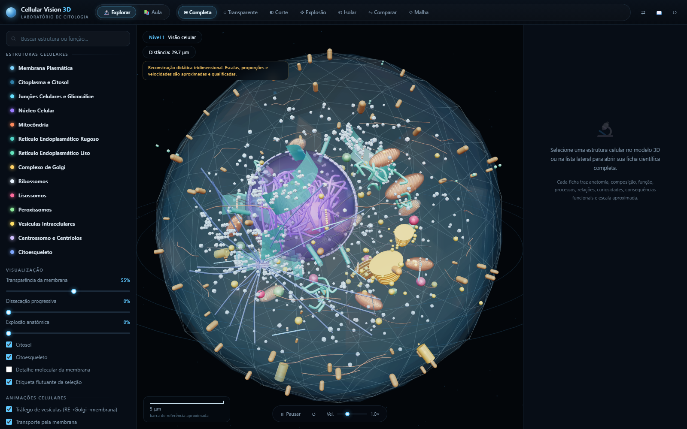
</p>

---

## Índice

- [Começando](#começando)
- [Capturas de tela](#capturas-de-tela)
- [Recursos do modelo 3D](#recursos-do-modelo-3d)
- [Modos de visualização](#modos-de-visualização)
- [Níveis de observação](#níveis-de-observação)
- [Conteúdo científico](#conteúdo-científico)
- [Os nove módulos de estudo](#os-nove-módulos-de-estudo)
- [Atalhos de teclado](#atalhos-de-teclado)
- [Detalhes técnicos](#detalhes-técnicos)
- [Arquitetura do código](#arquitetura-do-código)
- [Validação](#validação)
- [Compatibilidade e desempenho](#compatibilidade-e-desempenho)
- [Acessibilidade](#acessibilidade)
- [Rigor e transparência científica](#rigor-e-transparência-científica)
- [Limitações conhecidas](#limitações-conhecidas)
- [Licença](#licença)

---

## Começando

### Uso direto (recomendado)

1. Baixe o repositório ou apenas o arquivo `index.html`.
2. Dê **duplo clique** em `index.html`.

Não é preciso instalar nada. O modelo tridimensional é carregado do CDN
`unpkg.com` (Three.js r160), portanto é necessária **conexão com a internet** na
primeira abertura. Todo o CSS e todo o JavaScript da aplicação já estão embutidos no
próprio arquivo — não existe etapa de build para o usuário final.

> Se preferir não depender de CDN, veja [Detalhes técnicos](#detalhes-técnicos) para
> embutir o Three.js localmente.

### Uso a partir do código-fonte

```bash
git clone https://github.com/Thomas-Adrian-Soler-Nilsson/cellular-vision-3d.git
cd cellular-vision-3d

# regerar o index.html a partir dos módulos em build/js/
node build/build.mjs
```

### Primeiros passos na interface

1. **Explore** — gire a célula com o mouse, use a roda para aproximar e clique em
   qualquer estrutura para abrir a ficha científica dela.
2. **Estude** — clique em **📚 Aula** na barra superior e percorra os módulos 0 a 8.
3. **Aprofunde** — use **⇋ Comparar** para fixar uma estrutura de referência e contrastar
   duas organelas lado a lado na ficha.

---

## Capturas de tela

| Visão completa | Núcleo selecionado |
|---|---|
|  | 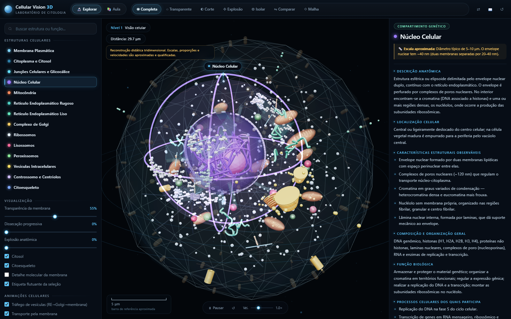 |
| Modelo íntegro com todas as organelas visíveis. | Halo pulsante, anéis de mira e etiqueta flutuante. |

| Mitocôndria isolada | Complexo de Golgi selecionado |
|---|---|
| 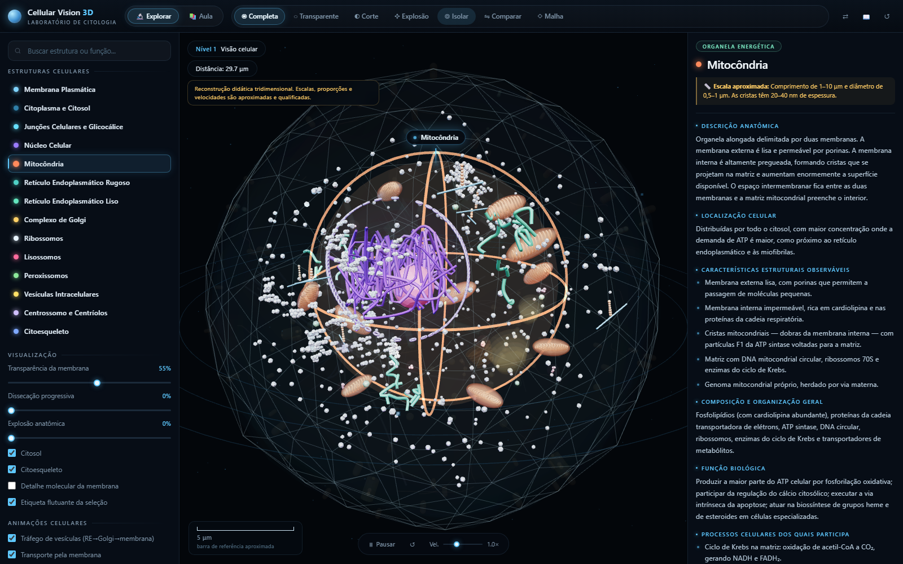 | 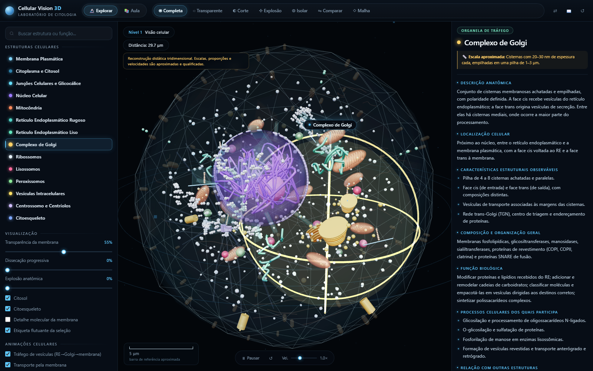 |
| Modo **◎ Isolar** com as demais estruturas atenuadas. | Destaque emissivo e atenuação do contexto. |

| Corte transversal | Explosão anatômica |
|---|---|
| 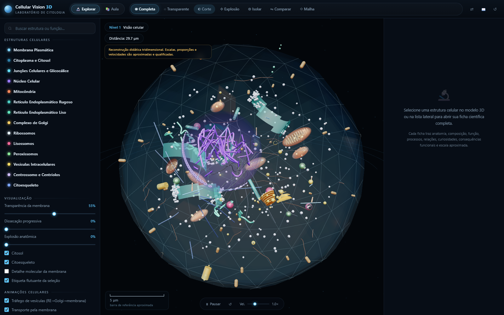 | 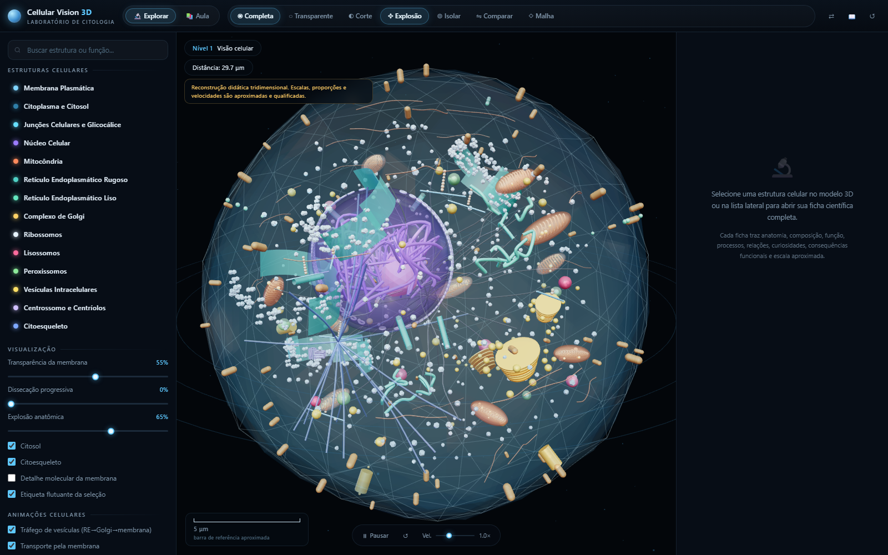 |
| Plano de recorte real calculado a partir da câmera. | Afastamento radial progressivo das organelas. |

| Retículo e membrana | Módulo 0 — célula vegetal |
|---|---|
| 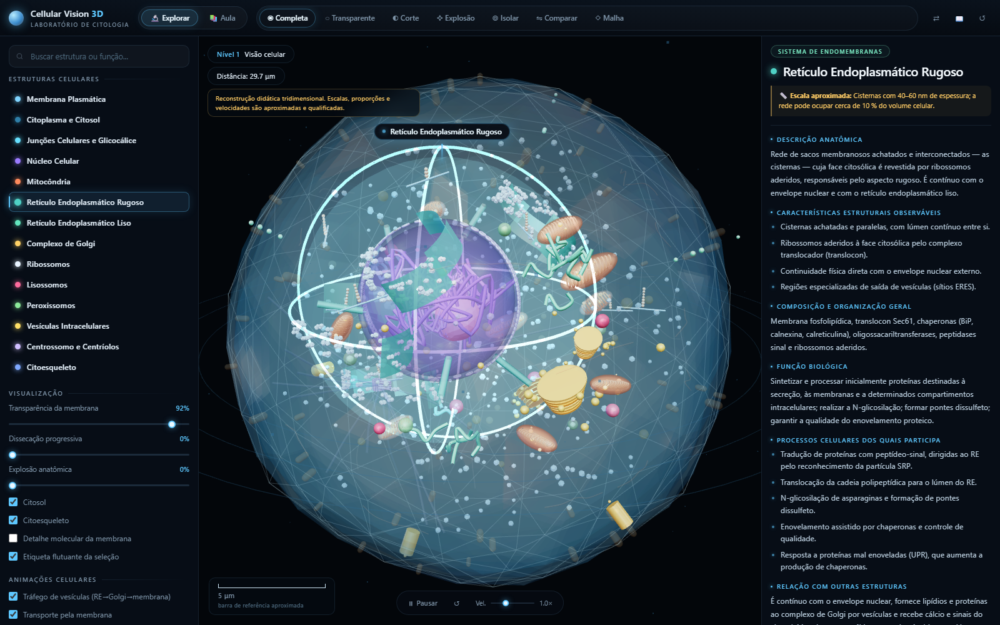 | 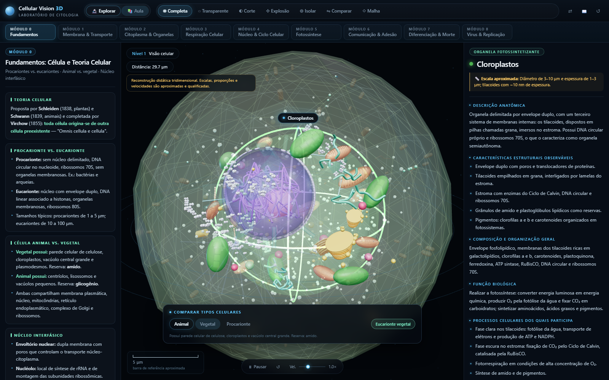 |
| Membrana com 92 % de transparência e RE rugoso destacado. | Parede de celulose, cloroplastos e vacúolo central. |

| Módulo 3 — respiração celular | Módulo 5 — fotossíntese |
|---|---|
| 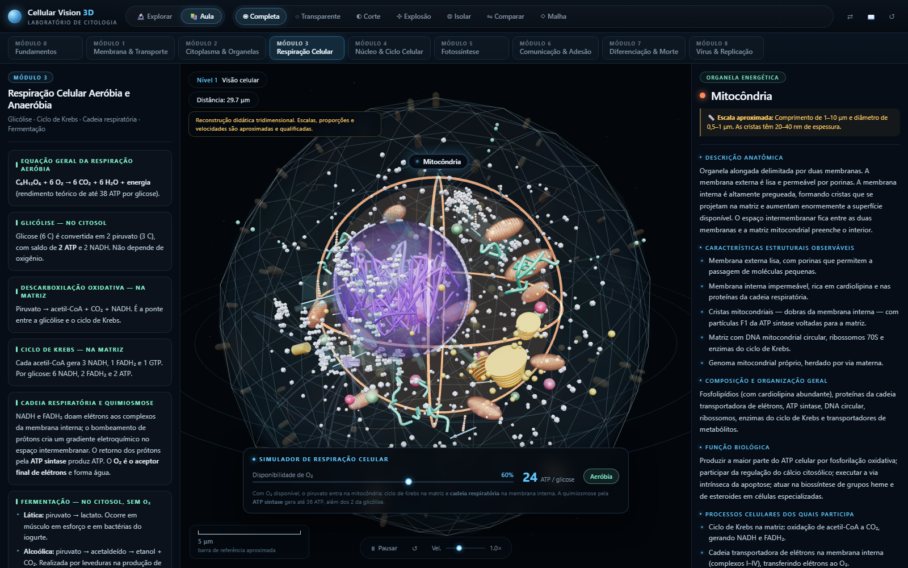 | 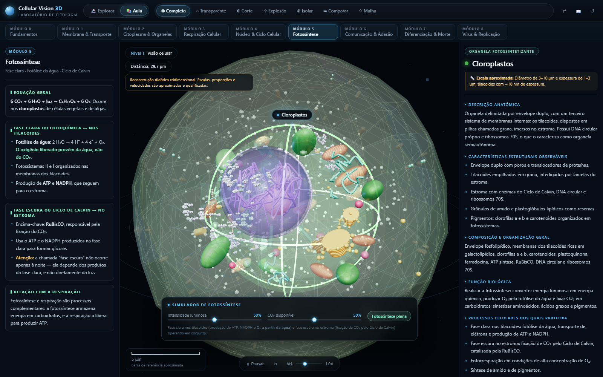 |
| Rendimento em ATP conforme a disponibilidade de O₂. | Fase clara, Ciclo de Calvin e limitação por luz ou CO₂. |

| Modo malha | Detalhe molecular da membrana |
|---|---|
| 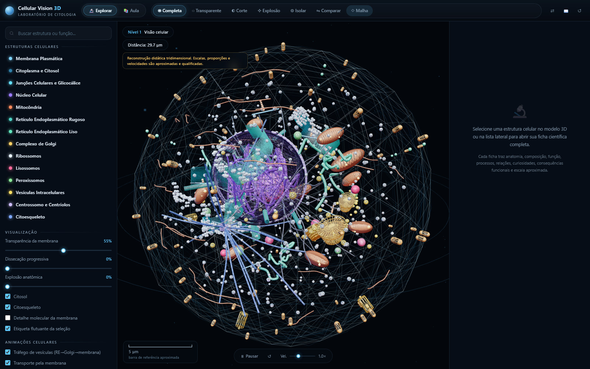 |  |
| Estrutura de arestas para leitura geométrica. | Cabeças de fosfolipídio nas duas faces da bicamada. |

---

## Recursos do modelo 3D

### Modelagem anatômica

Cada estrutura foi construída com geometria própria — o projeto não usa esferas genéricas
como substituto de organelas:

- **Membrana plasmática** — malha orgânica deformada por ruído procedural, dois folhetos
  distintos, **1.400 cabeças de fosfolipídio instanciadas** em cada face, **64 proteínas
  integrais** transmembrana e silhueta de reforço.
- **Citosol** — volume interno com material físico translúcido e profundidade controlada.
- **Núcleo** — envelope duplo com espaço perinuclear, **76 complexos de poro** instanciados,
  **26 filamentos de cromatina** modelados por curvas Catmull-Rom e nucléolo deformado.
- **Retículo endoplasmático rugoso** — cinco regiões de cisternas curvas com centenas de
  ribossomos instanciados aderidos, além de **pontes visíveis de continuidade com o
  envelope nuclear**.
- **Retículo endoplasmático liso** — rede tubular ramificada em três regiões celulares.
- **Complexo de Golgi** — três pilhas empilhadas com polaridade cis/trans e vesículas
  brotando das margens.
- **Mitocôndrias** — **10 unidades** alongadas, cada uma com membrana externa, membrana
  interna, matriz, cristas internas em anel e **DNA mitocondrial circular**.
- **Ribossomos** — 360 partículas livres no citosol, evitando o interior do núcleo.
- **Lisossomos** — 6 vesículas com deformação individualizada e grânulos de conteúdo.
- **Peroxissomos** — 5 unidades com núcleo cristalino octaédrico.
- **Vesículas** — 28 em trânsito pelo citoplasma.
- **Centrossomo** — dois centríolos perpendiculares, cada um com as **9 trincas** de
  microtúbulos.
- **Citoesqueleto** — 18 microtúbulos irradiando do centrossomo, 28 filamentos de actina
  no córtex e 16 filamentos intermediários.

### Variações de tipo celular

| | Animal | Vegetal | Procariótica |
|---|:---:|:---:|:---:|
| Membrana plasmática | ✅ | ✅ | ✅ |
| Parede celular | — | ✅ celulose | cápsula |
| Núcleo com envelope | ✅ | ✅ | — nucleoide |
| Mitocôndrias | ✅ | ✅ | — |
| Cloroplastos | — | ✅ com grana | — |
| Vacúolo central | — | ✅ | — |
| Centríolos | ✅ | — | — |
| Ribossomos | 80S | 80S | 70S |

### Animações de processos

Quatro sistemas animados podem ser ligados e desligados individualmente, com controle de
reproduzir, pausar, reiniciar e velocidade de 0,1× a 3,0×:

- **Tráfego de vesículas** — cinco rotas saindo do retículo endoplasmático, atravessando o
  complexo de Golgi e alcançando a membrana plasmática.
- **Transporte pela membrana** — difusão facilitada e bombas com proteínas carreadoras
  visíveis atravessando a bicamada.
- **Produção de ATP** — partículas que se movem dentro das mitocôndrias; a intensidade é
  proporcional à disponibilidade de oxigênio e cessa em anaerobiose.
- **Tradução ribossômica** — fitas de mRNA com cadeia polipeptídica em crescimento, tanto
  em ribossomos livres quanto aderidos ao RE rugoso.

### Identificação visual da seleção

Selecionar uma organela aciona, em conjunto, cinco mecanismos complementares:

1. **Halo pulsante** aditivo dimensionado ao volume real da estrutura.
2. **Três anéis de mira** perpendiculares entre si, em rotação contínua.
3. **Realce emissivo** de 2,2× nos materiais pertencentes à estrutura.
4. **Atenuação do contexto** — estruturas volumosas de fundo caem para 22 % da opacidade.
5. **Etiqueta flutuante** projetada em coordenadas de tela, ancorada acima da estrutura.

O **modo ⇋ Comparar** fixa uma estrutura de referência e gera, dentro da ficha, uma tabela
contrastando classificação, escala, função principal e características das duas organelas.

---

## Modos de visualização

| Botão | Modo | O que faz |
|---|---|---|
| ◉ **Completa** | `full` | Restaura todos os parâmetros para a visão inicial. |
| ◌ **Transparente** | `transparent` | Alterna a membrana entre 55 % e 10 % de opacidade. |
| ◐ **Corte** | `section` | Ativa plano de recorte real, recalculado a cada quadro a partir da direção da câmera. |
| ✥ **Explosão** | `explode` | Afasta radialmente as organelas da posição original, com interpolação suave. |
| ◎ **Isolar** | `isolate` | Reduz a 5 % da opacidade tudo que não pertence à estrutura selecionada. |
| ⇋ **Comparar** | `compare` | Fixa uma estrutura como referência para comparação lado a lado. |
| ◇ **Malha** | `wire` | Exibe todas as geometrias como arestas. |

Além dos botões, três controles contínuos permitem ajuste fino:

- **Transparência da membrana** — de 0 % a 100 %.
- **Dissecação progressiva** — afasta e esmaece as camadas externas até expor o interior.
- **Explosão anatômica** — de 0 % a 100 %, controlada manualmente.

O botão **⇄** ativa o realce do **sistema de endomembranas**, destacando simultaneamente
membrana, núcleo, retículo rugoso, retículo liso, Golgi, vesículas e lisossomos — o
conjunto que funciona de forma integrada no tráfego e na síntese de proteínas e lipídios.

---

## Níveis de observação

A interface classifica automaticamente o nível conforme a distância da câmera e exibe uma
**barra de escala dinâmica** em micrômetros ou nanômetros, sempre rotulada como aproximada.

| Nível | Nome | Faixa de distância | Aviso metodológico |
|---|---|---|---|
| **1** | Visão celular | > 26 μm | Reconstrução didática; escalas e velocidades aproximadas. |
| **2** | Visão subcelular | 14 – 26 μm | Reconstrução didática; escalas e velocidades aproximadas. |
| **3** | Visão estrutural | 6 – 14 μm | Detalhes internos ampliados de forma didática. |
| **4** | Visão molecular ilustrativa | < 6 μm | Esquemático e sem proporção real em relação aos níveis 1–3. |

No nível 4 pode ser ativado o **detalhe molecular da membrana**, com as cabeças polares dos
fosfolipídios nas duas faces da bicamada.

---

## Conteúdo científico

**18 estruturas**, cada uma com uma ficha de **dez campos obrigatórios**: descrição
anatômica, localização celular, características estruturais observáveis, composição e
organização geral, função biológica, processos celulares, relação com outras estruturas,
curiosidades científicas, consequências funcionais e escala aproximada.

| Estrutura | Tipo | Destaques da ficha |
|---|---|---|
| Membrana plasmática | Envoltório celular | Mosaico fluido, assimetria de folhetos, jangadas lipídicas |
| Citoplasma e citosol | Compartimento | Glicólise, ciclose, alta concentração proteica |
| Junções celulares e glicocálice | Especializações | Desmossomos, junções gap, oclusão, plasmodesmos |
| Núcleo celular | Compartimento genético | Envelope duplo, poros, cromatina, nucléolo, lâmina nuclear |
| Mitocôndria | Organela energética | Cristas, ciclo de Krebs, cadeia respiratória, mtDNA |
| Retículo endoplasmático rugoso | Endomembranas | Translocon, N-glicosilação, controle de qualidade, UPR |
| Retículo endoplasmático liso | Endomembranas | Lipídios, esteroides, citocromo P450, cálcio |
| Complexo de Golgi | Tráfego | Glicosilação, face cis/trans, TGN, manose-6-fosfato |
| Ribossomos | Ribonucleoproteico | Subunidades 40S/60S, sítios A/P/E, polissomos |
| Lisossomos | Organela digestiva | Hidrolases ácidas, V-ATPase, autofagia, heterofagia |
| Peroxissomos | Organela oxidativa | Catalase, β-oxidação de cadeia muito longa, plasmalogênios |
| Vesículas intracelulares | Transportadores | COPI, COPII, clatrina, Rab e SNARE |
| Centrossomo e centríolos | Organizador de microtúbulos | 9 trincas, material pericentriolar, fuso mitótico |
| Citoesqueleto | Rede de filamentos | Microtúbulos, actina, filamentos intermediários, motores |
| Parede celular vegetal | Envoltório vegetal | Celulose, hemicelulose, pectina, lignina, plasmodesmos |
| Cloroplastos | Fotossintetizante | Tilacoides, grana, estroma, RuBisCO, fotólise da água |
| Vacúolo central | Armazenamento vegetal | Tonoplasto, antocianinas, turgor, defesa |
| Nucleoide e cromossomo bacteriano | Material genético | DNA circular, plasmídeos, fissão binária |

A busca lateral filtra por **nome, tipo, função, anatomia, processos e curiosidades** —
é possível digitar "fotólise", "NADPH" ou "apoptose" e encontrar as estruturas
correspondentes.

---

## Os nove módulos de estudo

Cada módulo é composto por **blocos de teoria**, um **simulador interativo** que altera o
modelo 3D em tempo real e uma **questão de múltipla escolha** com correção comentada e
gabarito, no estilo ENEM/Unicamp.

| Módulo | Tema | Simulador |
|:---:|---|---|
| **0** | Fundamentos e teoria celular | Comparação entre célula animal, vegetal e procarionte |
| **1** | Membrana plasmática e transporte | Osmose com variação real do volume celular |
| **2** | Citoplasma e organelas | Exploração por clique, com atalhos para oito organelas |
| **3** | Respiração celular | Disponibilidade de O₂ e rendimento em ATP por glicose |
| **4** | Núcleo e ciclo celular | Fases G1, S, G2, prófase, metáfase, anáfase e telófase |
| **5** | Fotossíntese | Intensidade luminosa e concentração de CO₂ |
| **6** | Comunicação e adesão celular | Desmossomo, junção gap e junção de oclusão |
| **7** | Diferenciação e morte celular | Potencialidade celular e apoptose progressiva |
| **8** | Vírus e replicação viral | Ciclo lítico e ciclo lisogênico |

### Efeitos no modelo 3D

- **Módulo 0** — troca o tipo celular, reconstruindo a lista de estruturas disponíveis e a
  geometria visível.
- **Módulo 1** — a célula ganha ou perde volume; a membrana muda de cor conforme o estado
  osmótico; o texto distingue lise, crenação, turgescência e plasmólise.
- **Módulo 3** — as mitocôndrias brilham proporcionalmente ao oxigênio disponível e o
  contador de ATP varia de 2 a 38.
- **Módulo 4** — a cromatina condensa-se progressivamente e o nucléolo desaparece na fase M.
- **Módulo 5** — força a célula vegetal e faz os cloroplastos brilharem conforme a luz.
- **Módulo 6** — constrói e destaca junções celulares reais na periferia da célula.
- **Módulo 7** — a célula retrai-se e a membrana perde definição conforme a apoptose avança.
- **Módulo 8** — partículas virais aproximam-se da membrana nos ciclos lítico e lisogênico.

---

## Atalhos de teclado

| Tecla | Ação |
|---|---|
| `R` | Restaura a visão inicial |
| `Espaço` | Reproduz ou pausa todas as animações |
| `Esc` | Desfaz a seleção atual |
| `I` | Ativa ou desativa o isolamento da estrutura selecionada |
| `C` | Ativa ou desativa o corte transversal |
| `←` `→` `↑` `↓` | Desloca a câmera e o ponto de foco |

---

## Detalhes técnicos

| Item | Valor |
|---|---|
| Biblioteca 3D | Three.js r160 via importmap de `unpkg.com` |
| Módulos de addon | `OrbitControls`, `RoomEnvironment` (PMREM) |
| Tone mapping | ACES Filmic, exposição 0,95 |
| Espaço de cor | sRGB na saída |
| Ambiente | PMREM a partir de `RoomEnvironment` |
| Iluminação | Hemisférica, ambiente, três direcionais e três pontuais coloridas |
| Atmosfera | `FogExp2` e nuvem de 460 partículas ao fundo |
| Instancing | Fosfolipídios, proteínas, poros, ribossomos e trincas de centríolo |
| Recorte | `renderer.clippingPlanes` com plano recalculado por quadro |
| Pixel ratio | Limitado a 2, para preservar desempenho em telas de alta densidade |
| Formato de entrega | HTML único, sem etapa de build para o usuário final |

### Embutir o Three.js localmente (uso offline)

O `index.html` referencia o CDN no bloco `importmap`. Para funcionar sem internet, baixe
`three.module.js` e a pasta `examples/jsm/` da versão r160, coloque-os ao lado do
`index.html` e ajuste o `importmap` para apontar aos arquivos locais.

---

## Arquitetura do código

O arquivo final é gerado a partir de módulos ES legíveis, mantidos em `build/js/`. O script
`build/build.mjs` remove as instruções `import` relativas, retira as palavras-chave
`export`, detecta colisões de nomes no escopo único do bundle e injeta o resultado no
marcador `/*__JS__*/` de `build/template.html`.

```
cellular-vision-3d/
├── index.html                 ← entrega final autocontida (abra este arquivo)
├── LICENSE                    ← MIT
├── README.md
├── docs/
│   └── screenshots/           ← 12 capturas usadas nesta documentação
└── build/
    ├── template.html          ← estrutura HTML + todo o CSS, com o marcador /*__JS__*/
    ├── build.mjs              ← inlina os módulos e gera o index.html
    ├── js/
    │   ├── 01-science.js      ← 18 estruturas com as 10 seções científicas
    │   ├── 02-modules.js      ← módulos 0–8: teoria, configuração de simulação e questão
    │   ├── 03-state.js        ← estado global, registro de organelas, utilidades geométricas
    │   ├── 04-cell.js         ← construção do modelo 3D completo
    │   ├── 05-anim.js         ← animações de processos celulares
    │   ├── 06-modes.js        ← modos de visualização e manipulação de materiais
    │   ├── 07-select.js       ← halo, anéis, etiqueta e comparação estrutural
    │   ├── 08-ui.js           ← lista, ficha científica, escala, teoria e questões
    │   ├── 09-sims.js         ← dez simuladores interativos
    │   └── 10-main.js         ← renderer, câmera, entrada, loop e inicialização
    ├── probe.mjs              ← verificação de inicialização e de WebGL
    ├── probe2.mjs             ← suíte de interação ponta a ponta
    ├── probe3.mjs             ← verificação de layout em cinco resoluções
    ├── shots.mjs              ← captura de doze estados representativos
    └── analyze_shots.py       ← análise de pixels das capturas
```

### Fluxo dos módulos

```
03-state.js ──► 04-cell.js ──► 05-anim.js
     │              │              │
     └──────────────┴──────────────┴──► 10-main.js ◄── 06-modes.js
                                          ▲   ▲   ▲
                          08-ui.js ───────┘   │   └─────── 09-sims.js
                                             │
                                       07-select.js
```

- `01-science.js` e `02-modules.js` são **dados puros**, sem dependência de Three.js.
- `03-state.js` é o único ponto de estado compartilhado; expõe `state`, `RENDER`,
  `matState`, `registry` e o índice de organelas.
- Nenhum módulo importa `10-main.js`; a comunicação inversa ocorre por três funções
  publicadas em `window` (`__cvSelect`, `__cvApplyModule`, `__cvSetPinned`).

---

## Validação

Quatro ferramentas automatizadas verificam o projeto em navegador **headless** com WebGL
por software:

```bash
node build/build.mjs                                # gera o index.html
node build/probe.mjs                                # inicialização e limpeza do overlay
node build/probe2.mjs                               # interação ponta a ponta
node build/probe3.mjs                               # layout em 5 resoluções
node build/shots.mjs                                # capturas em build/_captures/
python build/analyze_shots.py docs/screenshots      # análise de pixels
```

### Cobertura

| Verificação | Escopo |
|---|---|
| `probe.mjs` | Boot sem erros, remoção do overlay de carregamento, canvas ativo, UI preenchida |
| `probe2.mjs` | **90 asserções**: fichas, busca, modos, sliders, toggles, animação, níveis, 9 módulos, questões, comparação, tipos celulares |
| `probe3.mjs` | 5 resoluções (1680 → 430 px), sem sobreposição de controles e sem rolagem horizontal |
| `analyze_shots.py` | Luminância, variância, contagem de cores e presença das cores-assinatura por captura |

### Resultados da última execução

- **90 de 90** verificações de interação aprovadas.
- **0** erros de runtime durante toda a bateria.
- Layout aprovado em **todas** as cinco resoluções testadas.
- **12 de 12** capturas com renderização 3D confirmada por análise de pixels.
- Sintaxe do bundle validada com `node --check`.

---

## Compatibilidade e desempenho

- **Navegadores** — Chrome, Edge, Firefox e Safari em versões atuais, com WebGL 2.
- **Fallback** — se o WebGL estiver indisponível, a página exibe uma mensagem explicativa
  em vez de permanecer em branco.
- **Desempenho** — `InstancedMesh` para tudo que se repete em grande número, contagem de
  partículas calibrada para manter fluidez, `pixelRatio` limitado a 2 e interpolações com
  fator dependente de `delta time` para comportamento consistente entre 30 e 144 Hz.
- **Toque** — `touch-action: none` no canvas, com `pointerdown`/`pointerup` distinguindo
  clique de arraste por um limiar de 6 px, o que permite girar a célula sem disparar
  seleções acidentais em telas sensíveis ao toque.

---

## Acessibilidade

- Atributos `role`, `aria-label` e `aria-selected` nos grupos de abas e controles.
- Anel de foco visível (`:focus-visible`) em botões, sliders, caixas de seleção e campos.
- Atalhos de teclado para todas as ações principais, incluindo pan da câmera.
- **Modo estudo** (📖), que amplia o corpo do texto e o conteúdo das fichas.
- Respeito a `prefers-reduced-motion`: animações e transições são praticamente desativadas.
- Layout responsivo de 1680 px até 430 px, com painéis deslizantes em telas pequenas.

---

## Rigor e transparência científica

O modelo é uma **reconstrução didática tridimensional**. Escalas, proporções e velocidades
são aproximadas e estão qualificadas na interface, nas fichas e no aviso permanente do
canto superior esquerdo — que muda de texto conforme o nível de observação.

Pontos de conteúdo tratados com cuidado explícito, verificados na bateria de testes:

- O oxigênio liberado na fotossíntese provém da **fotólise da água**, não do CO₂.
- A "fase escura" depende dos produtos da fase clara e **não ocorre apenas no escuro**.
- A fermentação produz saldo de **2 ATP** por glicose, contra até **38** na respiração aeróbia.
- A bomba de Na⁺/K⁺-ATPase transporta **3 Na⁺ para fora e 2 K⁺ para dentro** por ATP.
- A apoptose **não desencadeia inflamação**, ao contrário da necrose.
- O vírus possui DNA **ou** RNA, nunca os dois, e é acelular.
- O crossing-over ocorre na **prófase I da meiose**.
- O envelope nuclear é **contínuo com o retículo endoplasmático rugoso**.
- As cristas mitocondriais são dobras da **membrana interna**.
- O limite de resolução do microscópio óptico é respeitado nas comparações de tamanho.

---

## Limitações conhecidas

- O modelo representa uma célula **idealizada**, não um tipo celular específico; as
  proporções de volume entre organelas são didáticas.
- O nível molecular é **esquemático** e não guarda proporção real com os níveis 1 a 3.
- A primeira carga depende de internet, por causa do CDN do Three.js.
- Módulos que exigem célula vegetal (5) ou procarionte (0) alteram o tipo celular
  automaticamente, o que é informado na própria interface.

---

## Licença

Distribuído sob a **Licença MIT**. Veja [LICENSE](LICENSE) para o texto completo.

```
Copyright (c) 2026 Thomas Adrian Soler Nilsson
```

Você pode usar, copiar, modificar, mesclar, publicar, distribuir, sublicenciar e vender
este software, desde que preserve o aviso de copyright e a licença.

---

<p align="center">
  Feito para o estudo de citologia · <b>Cellular Vision 3D</b>
</p>