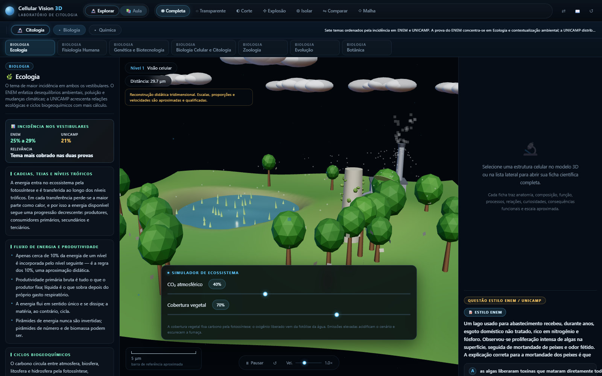
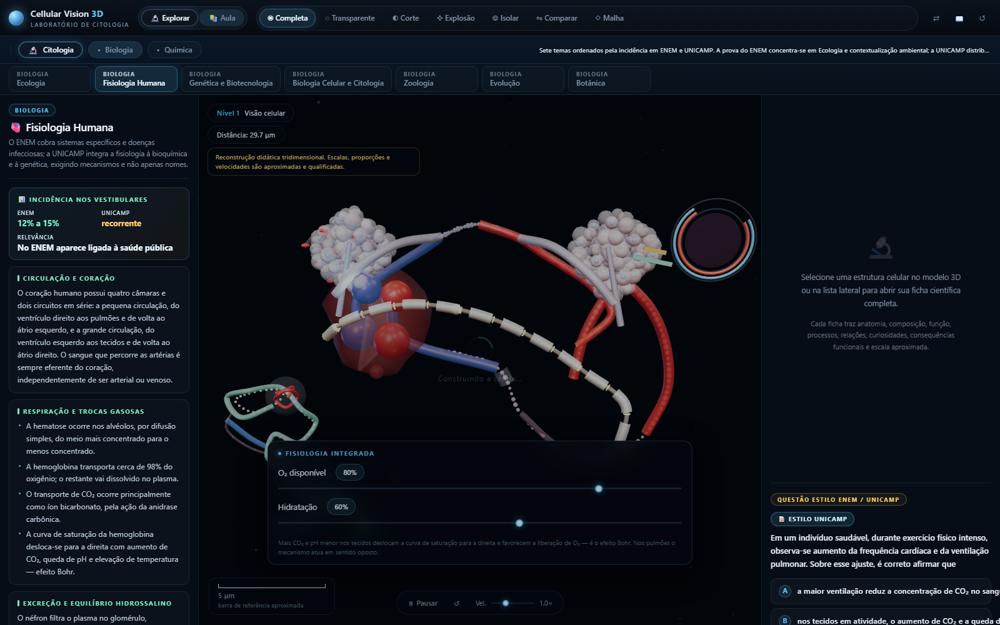
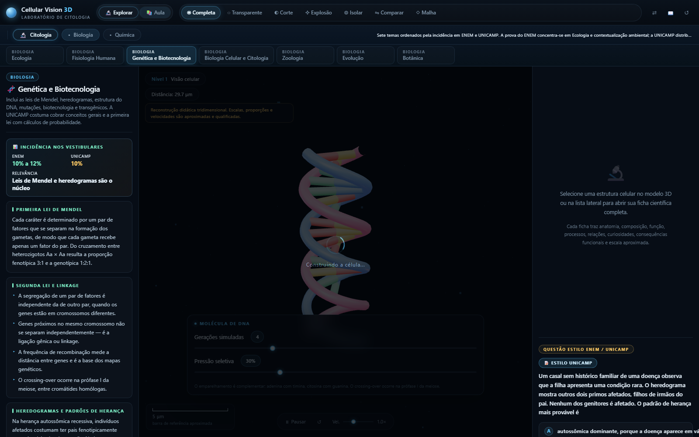
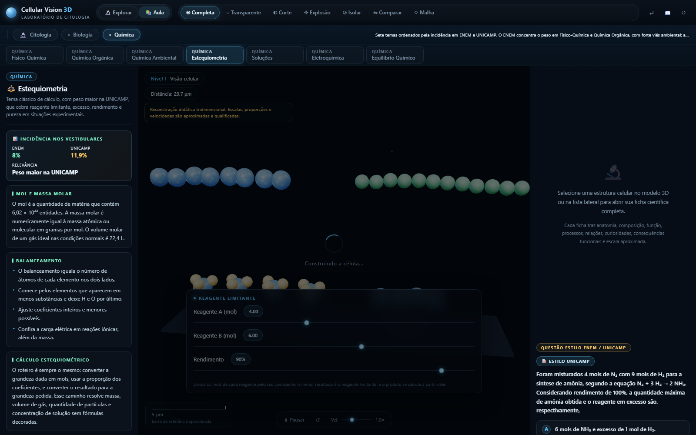
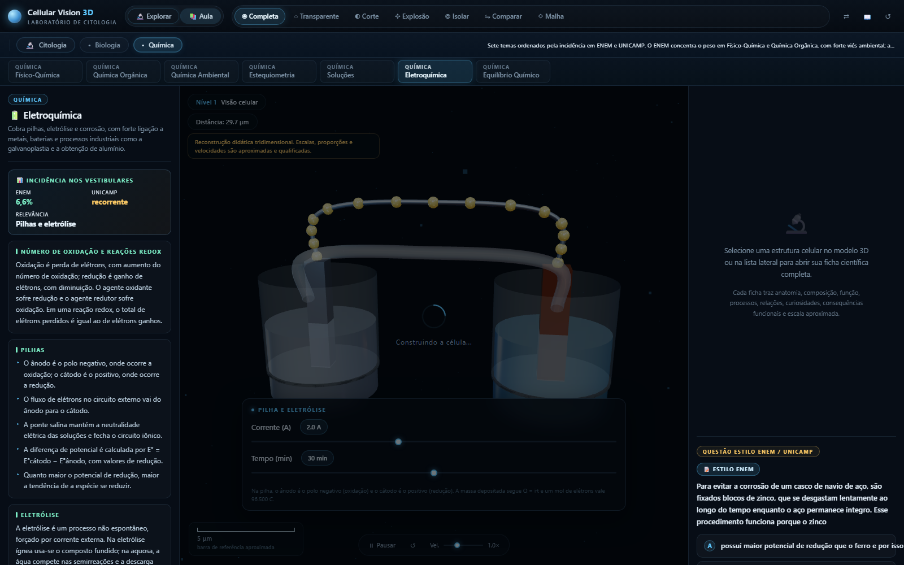
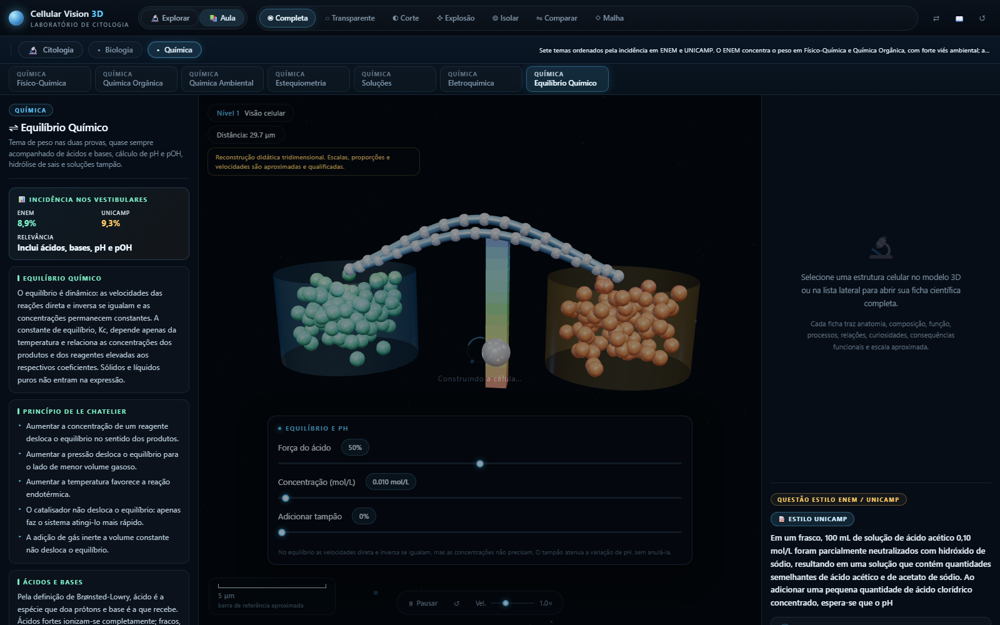

# Lab Bio-Química — Laboratório Interativo para ENEM e UNICAMP

Plataforma educacional 3D com **três trilhas de estudo** para os vestibulares:
um modelo de **citologia** navegável (célula eucariótica animal, vegetal e
procarionte), uma trilha de **Biologia** e uma trilha de **Química**, esta última
com cenas moleculares próprias. Cada tema traz **teoria**, **simulador
interativo 3D** e **questão estilo ENEM/Unicamp com correção comentada**.

Os temas das trilhas de Biologia e Química foram priorizados pela **incidência
real** nas duas provas, e cada um exibe seu peso comparado na interface.

Construído em **Three.js r160** e distribuído como **um único arquivo HTML
autocontido**: sem instalação, sem servidor, sem dependências locais.

<p align="center">
  
</p>

---

## Índice

- [Começando](#começando)
- [As três trilhas](#as-três-trilhas)
- [Incidência ENEM × UNICAMP](#incidência-enem--unicamp)
- [Capturas de tela](#capturas-de-tela)
- [Recursos do modelo 3D](#recursos-do-modelo-3d)
- [As cenas das trilhas](#as-cenas-das-trilhas)
- [Conteúdo científico](#conteúdo-científico)
- [Atalhos de teclado](#atalhos-de-teclado)
- [Detalhes técnicos](#detalhes-técnicos)
- [Arquitetura do código](#arquitetura-do-código)
- [Validação](#validação)
- [Compatibilidade e desempenho](#compatibilidade-e-desempenho)
- [Acessibilidade](#acessibilidade)
- [Rigor e transparência científica](#rigor-e-transparência-científica)
- [Licença](#licença)

---

## Começando

### Uso direto (recomendado)

1. Baixe o repositório — ou apenas o arquivo `index.html`.
2. Dê **duplo clique** em `index.html`.

O modelo tridimensional é carregado do CDN `unpkg.com` (Three.js r160), portanto
é necessária **conexão com a internet** na primeira abertura. Todo o CSS e todo o
JavaScript da aplicação já estão embutidos no próprio arquivo — não existe etapa
de build para o usuário final.

### Uso a partir do código-fonte

```bash
git clone https://github.com/Thomas-Adrian-Soler-Nilsson/lab-bio-quimica.git
cd lab-bio-quimica

# regenerar o index.html a partir dos módulos em src/
node tools/build.mjs
```

### Primeiros passos

1. **🔬 Explore** — gire a célula, use a roda para aproximar e clique em qualquer
   estrutura para abrir a ficha científica dela.
2. **📚 Aula** — entre no modo aula e use a **barra de trilhas** para escolher
   entre Citologia, Biologia e Química.
3. **Responda** — cada tema termina com uma questão de vestibular com correção
   comentada e gabarito.

---

## As três trilhas

| | Citologia (9 módulos) | Biologia (7 temas) | Química (7 temas) |
|---|---|---|---|
| **Cena 3D** | Célula eucariótica completa | Ecossistema e corpo humano | Moléculas, pilha e béqueres |
| **Foco** | Estrutura e função das organelas | Temas de maior incidência | Temas de maior incidência |
| **Questões** | 9 | 7 | 7 |
| **Simuladores** | 9 dedicados | 5 paramétricos + 1 dedicado | 7 paramétricos |

Cada tema da interface exibe um **cartão de incidência** com o peso comparado do
assunto no ENEM e na UNICAMP, além do selo `📝 Estilo ENEM` ou
`📝 Estilo UNICAMP` sobre o enunciado da questão.

---

## Incidência ENEM × UNICAMP

A priorização dos temas seguiu o levantamento abaixo, disponível também na
própria interface.

### 📊 Biologia

| Tema | ENEM | UNICAMP | No laboratório |
| :--- | :--- | :--- | :--- |
| **Ecologia** | ~25% a 29% | ~21% | `ecologia` |
| **Fisiologia Humana** | ~12% a 15% | recorrente | `fisiologia-humana` |
| **Genética e Biotecnologia** | ~10% a 12% | ~10% | `genetica` |
| **Biologia Celular** | ~10% a 12% | ~5% | `biologia-celular` |
| **Zoologia** | ~13% a 15% | ~10% | `zoologia` |
| **Evolução** | menor | ~11,5% | `evolucao` |
| **Botânica** | ~7,7% | recorrente | `botanica` |

### 🧪 Química

| Tema | ENEM | UNICAMP | No laboratório |
| :--- | :--- | :--- | :--- |
| **Físico-Química** | ~28,4% | ~18,8% | `fisico-quimica` |
| **Química Orgânica** | ~28,4% | relevante | `organica` |
| **Química Ambiental** | ~18,5% | ~12,9% | `ambiental` |
| **Estequiometria** | ~8% | ~11,9% | `estequiometria` |
| **Soluções** | ~6,6% | ~9,3% | `solucoes` |
| **Eletroquímica** | ~6,6% | recorrente | `eletroquimica` |
| **Equilíbrio Químico** | ~8,9% | ~9,3% | `equilibrio` |

**Diferença de estilo entre as provas:** o ENEM prioriza Ecologia, Físico-Química
e Química Orgânica, com questões contextualizadas e interdisciplinares; a UNICAMP
exige equilíbrio maior entre os temas, com peso mais alto em Evolução e
Biologia Celular e destaque em Estequiometria, Soluções e Equilíbrio.

---

## Capturas de tela

| Visão completa | Núcleo selecionado |
|---|---|
|  |  |
| Todas as organelas visíveis. | Halo, anéis de mira e etiqueta flutuante. |

| Corte transversal | Explosão anatômica |
|---|---|
|  |  |
| Plano de recorte real. | Afastamento radial das organelas. |

| Módulo 3 — respiração | Módulo 5 — fotossíntese |
|---|---|
|  |  |
| ATP conforme o O₂ disponível. | Fase clara e Ciclo de Calvin. |

| Biologia — Ecologia | Biologia — Fisiologia Humana |
|---|---|
|  |  |
| Ecossistema com ciclo do carbono e eutrofização. | Coração, pulmões, néfron e efeito Bohr. |

| Biologia — Genética | Química — Estequiometria |
|---|---|
|  |  |
| Dupla-hélice com emparelhamento A-T e C-G. | Reagente limitante em N₂ + 3 H₂ → 2 NH₃. |

| Química — Eletroquímica | Química — Equilíbrio |
|---|---|
|  |  |
| Pilha de Daniell com ponte salina. | Câmaras em equilíbrio e escala de pH. |

As demais capturas estão em [`docs/screenshots/`](docs/screenshots).

---

## Recursos do modelo 3D

### Trilha de Citologia

- **18 estruturas** com ficha científica de **dez campos obrigatórios**, incluindo
  localização celular e escala aproximada qualificada.
- Membrana com **bicamada de fosfolipídios instanciada**, **64 proteínas
  integrais** e silhueta de reforço.
- Núcleo com **76 complexos de poro**, **26 filamentos de cromatina** e nucléolo.
- **10 mitocôndrias** com cristas e DNA mitocondrial circular.
- RE rugoso com ribossomos instanciados e **pontes de continuidade com o
  envelope nuclear**; RE liso tubular ramificado.
- **3 pilhas de Golgi** com polaridade cis/trans; lisossomos, peroxissomos com
  núcleo cristalino, centríolos com 9 trincas e citoesqueleto triplo.
- Tipos celulares **animal**, **vegetal** (parede, cloroplastos, vacúolo) e
  **procarionte** (nucleoide, cápsula).
- **7 modos de visualização:** completa, transparente, corte, explosão, isolar,
  comparar e malha.
- **4 animações de processos:** tráfego de vesículas, transporte pela membrana,
  produção de ATP e tradução ribossômica.

### Trilha de Biologia — cena de ecossistema

Terreno ondulado com lago, **cobertura vegetal variável**, nuvens à deriva,
**chaminé com fumaça** que escurece conforme a emissão, **cano de esgoto** cujo
tratamento limpa a água do lago, **partículas do ciclo do carbono** absorvidas
pelas copas, **mariposas claras e escuras** para o melanismo industrial, tronco
com liquens, **algas que proliferam na eutrofização** e **folha em destaque com
estômatos** que abrem com água e luz.

### Trilha de Biologia — cena do corpo humano

Coração com quatro câmaras e sístole/diástole animadas, **dois circuitos
completos** (pequena e grande circulação) com o sentido correto do fluxo,
pulmões com alvéolos que inflam conforme a ventilação, **hemácias que mudam de
cor pelo efeito Bohr**, **néfron completo** com glomérulo, túbulos, ducto
coletor e reabsorção dependente do ADH, e **feixe nervoso com potencial de
ação** percorrendo a bainha de mielina.

### Trilha de Química — sete cenas moleculares

1. **Estequiometria** — moléculas de N₂ e H₂ que reagem conforme a proporção
   1:3:2, mostrando o reagente limitante e o excesso que sobra.
2. **Soluções** — béquer cujo volume cresce e cuja cor clareia, com as partículas
   de soluto conservando a quantidade de mols (C₁V₁ = C₂V₂).
3. **Equilíbrio** — duas câmaras com tráfego de velocidades iguais e **escala de
   pH** com marcador, mostrando o efeito do ácido forte x fraco e a atenuação do
   tampão.
4. **Cinética** — perfil de energia cuja **barreira abaixa com o catalisador**,
   com partículas cuja velocidade cresce com a temperatura.
5. **Eletroquímica** — pilha de Daniell com dois eletrodos, **ponte salina**,
   elétrons percorrendo o fio externo e **depósito proporcional a Q = i·t**.
6. **Orgânica** — cadeia carbônica que cresce até 12 carbonos, com **ligações
   duplas** paralelas e hidrogênios completando a tetravalência.
7. **Genética** — dupla-hélice com **emparelhamento complementar A-T e C-G** que
   se abre progressivamente conforme as gerações avançam.

---

## Conteúdo científico

**18 estruturas celulares** e **14 temas de trilha**, cada um com teoria em seis
blocos, incidência comparada, simulador e questão de cinco alternativas com
correção comentada.

- **Citologia (9 módulos):** fundamentos, membrana e transporte, citoplasma e
  organelas, respiração celular, núcleo e ciclo celular, fotossíntese,
  comunicação e adesão, diferenciação e morte, vírus e replicação.
- **Biologia (7 temas):** ecologia, fisiologia humana, genética e biotecnologia,
  biologia celular, zoologia, evolução, botânica.
- **Química (7 temas):** físico-química, química orgânica, química ambiental,
  estequiometria, soluções, eletroquímica, equilíbrio químico.

A busca lateral da citologia filtra por nome, tipo, função, anatomia, processos e
curiosidades — é possível digitar "fotólise", "NADPH" ou "apoptose".

---

## Atalhos de teclado

| Tecla | Ação |
|---|---|
| `R` | Restaura a visão inicial |
| `Espaço` | Reproduz ou pausa as animações |
| `Esc` | Desfaz a seleção atual |
| `I` | Ativa ou desativa o isolamento |
| `C` | Ativa ou desativa o corte transversal |
| `←` `→` `↑` `↓` | Desloca a câmera |

---

## Detalhes técnicos

| Item | Valor |
|---|---|
| Biblioteca 3D | Three.js r160 via importmap de `unpkg.com` |
| Tone mapping | ACES Filmic, exposição 0,95 |
| Iluminação | Hemisférica, ambiente, 3 direcionais e 3 pontuais |
| Instancing | Fosfolipídios, poros, ribossomos e partículas das trilhas |
| Recorte | `renderer.clippingPlanes` recalculado por quadro |
| Pixel ratio | Limitado a 2 |
| Cenas 3D | 1 célula + 1 ecossistema + 1 corpo humano + 7 moleculares |
| Formato | HTML único, sem build para o usuário final |

---

## Arquitetura do código

O arquivo final é gerado a partir de módulos ES legíveis, mantidos em `src/`
organizados **por domínio**. O script `tools/build.mjs` remove os imports
relativos, retira as palavras-chave `export`, detecta colisões de nomes no
escopo único do bundle e injeta o resultado no marcador `/*__JS__*/` de
`tools/template.html`.

```
lab-bio-quimica/
├── index.html                 ← entrega final autocontida (abra este arquivo)
├── LICENSE                    ← MIT
├── README.md
├── docs/
│   └── screenshots/           ← 18 capturas usadas nesta documentação
├── src/
│   ├── dados/                 ← conteúdo, sem dependência de Three.js
│   │   ├── citologia.js        18 estruturas com 10 seções científicas
│   │   ├── modulos.js          9 módulos da trilha de citologia
│   │   ├── biologia.js         7 temas de Biologia para ENEM/Unicamp
│   │   ├── quimica.js          7 temas de Química para ENEM/Unicamp
│   │   └── trilhas.js          registro unificado e tabela de incidência
│   ├── nucleo/                ← infraestrutura da aplicação
│   │   ├── estado.js           estado global e utilidades geométricas
│   │   ├── visualizacao.js     modos de visualização e materiais
│   │   ├── selecao.js          halo, anéis, etiqueta e comparação
│   │   └── motor.js            renderer, câmera, loop e boot
│   ├── cenas/                 ← as quatro cenas 3D
│   │   ├── celula.js           modelo de citologia
│   │   ├── animacoes.js        animações dos processos celulares
│   │   ├── ecossistema.js      cena de Ecologia, Botânica, Zoologia e Evolução
│   │   ├── sistema-humano.js   cena de Fisiologia Humana
│   │   ├── moleculas.js        7 cenas moleculares de Química
│   │   └── registro.js         gerenciador de troca de cenas
│   └── interface/
│       ├── ui.js               fichas, teoria, questões e barras
│       └── simuladores.js      simuladores dedicados + fábrica genérica
└── tools/
    ├── template.html           esqueleto HTML + CSS com o marcador /*__JS__*/
    ├── build.mjs               inlina os módulos e gera o index.html
    ├── probe.mjs               verificação de inicialização
    ├── probe2.mjs              suíte de citologia (90 asserções)
    ├── probe3.mjs              layout em 5 resoluções
    ├── probe4.mjs              suíte das trilhas de Biologia e Química
    ├── shots.mjs               18 capturas representativas
    └── analyze_shots.py        análise de pixels das capturas
```

### Convenções

- Cada arquivo de cena usa um **prefixo próprio** em todo nome de nível superior
  (`eco`, `hum`, `mol`), garantindo que o bundle de escopo único não tenha
  colisões — e o build aborta se houver.
- `src/dados/` é **conteúdo puro**: nenhum arquivo ali importa Three.js.
- Um **único contrato de cena** (`build`, `apply`, `tick`, `params`) permite que o
  gerenciador troque de trilha sem caso especial por tema.
- Os **simuladores das trilhas são paramétricos**: um único simulador genérico
  gera os controles a partir de `sim.parametros` declarado no próprio tema.

---

## Validação

Cinco ferramentas automatizadas verificam o projeto em navegador **headless**
com WebGL por software:

```bash
node tools/build.mjs                    # gera o index.html (aborta em conflito)
node tools/probe.mjs                   # inicialização e WebGL
node tools/probe2.mjs                  # citologia: 90 asserções
node tools/probe3.mjs                  # layout em 5 resoluções
node tools/probe4.mjs                  # trilhas: troca de cena, temas e questões
node tools/shots.mjs --docs            # capturas para a documentação
python tools/analyze_shots.py docs/screenshots
```

### Resultados da última execução

| Verificação | Resultado |
|---|---|
| Build + `node --check` | OK, 17 módulos inlinados, 0 conflitos |
| `probe.mjs` (boot) | 0 erros, overlay limpo, canvas ativo |
| `probe2.mjs` (citologia) | **90 de 90** asserções, 0 erros de runtime |
| `probe3.mjs` (layout) | OK nas 5 resoluções, sem sobreposição |
| `probe4.mjs` (trilhas) | **125 de 125** asserções, 0 erros de runtime |

A `probe4` confirma, para cada um dos 14 temas: teoria em seis blocos, cartão de
incidência, questão com cinco alternativas, cena 3D correta, simulador montado e
controles que alteram de fato os parâmetros da cena — incluindo a sub-cena
química ativa e o retorno seguro à citologia.

---

## Compatibilidade e desempenho

- **Navegadores** — Chrome, Edge, Firefox e Safari atuais, com WebGL 2.
- **Fallback** — sem WebGL, a página exibe mensagem explicativa em vez de travar.
- **Desempenho** — `InstancedMesh` para tudo que se repete, `pixelRatio` ≤ 2,
  animações dependentes de `delta time` e cenas ocultas que não gastam quadro.
- **Toque** — `touch-action: none` no canvas e limiar de 6 px distinguindo
  clique de arraste.

---

## Acessibilidade

- `role`, `aria-label` e `aria-selected` nas trilhas, módulos e controles.
- Anel de foco visível (`:focus-visible`) em todos os controles.
- Atalhos de teclado para as ações principais.
- **Modo estudo** (📖) com texto ampliado.
- Respeito a `prefers-reduced-motion`.
- Layout responsivo de 1680 px a 430 px.

---

## Rigor e transparência científica

O modelo é uma **reconstrução didática**. Escalas, proporções e velocidades são
aproximadas e qualificadas na interface, nas fichas e no aviso permanente que
muda de texto conforme o nível de observação.

Pontos verificados com cuidado explícito, cobertos pelas sondagens:

- O oxigênio da fotossíntese provém da **fotólise da água**, não do CO₂.
- A "fase escura" **não ocorre apenas no escuro**: depende dos produtos da fase clara.
- A fermentação produz **2 ATP**; a respiração aeróbia, até **38**.
- A Na⁺/K⁺-ATPase transporta **3 Na⁺ para fora e 2 K⁺ para dentro** por ATP.
- A apoptose **não desencadeia inflamação**; a necrose, sim.
- O vírus possui DNA **ou** RNA, nunca os dois.
- O crossing-over ocorre na **prófase I da meiose**.
- O envelope nuclear é **contínuo com o RE rugoso**.
- No melanismo industrial, as mariposas escuras **já existiam** na população.
- O catalisador **não desloca o equilíbrio**: apenas abaixa a energia de ativação.
- Na pilha, o **ânodo é o polo negativo** (oxidação) e o cátodo, o positivo.
- Sólidos e líquidos puros **não entram** na constante de equilíbrio.
- pH + pOH = 14 a 25 °C; cada unidade de pH vale **10×** em [H⁺].
- A hematose é **difusão simples**; o CO₂ viaja principalmente como bicarbonato.
- No DNA, o emparelhamento é complementar: **A-T e C-G**.

---

## Licença

Distribuído sob a **Licença MIT**. Veja [LICENSE](LICENSE).

```
Copyright (c) 2026 Thomas Adrian Soler Nilsson
```

---

<p align="center">
  Feito para o estudo de Biologia e Química para ENEM e UNICAMP · <b>Lab Bio-Química</b>
</p>